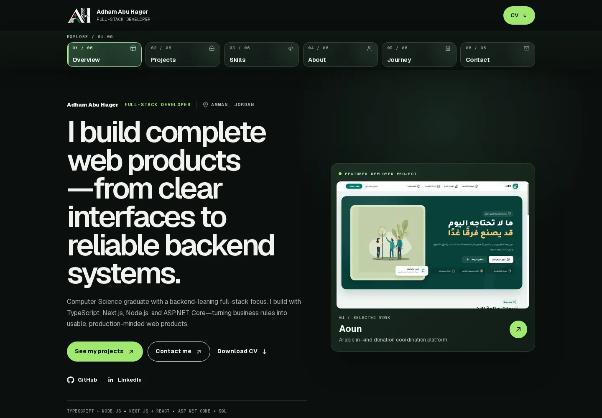
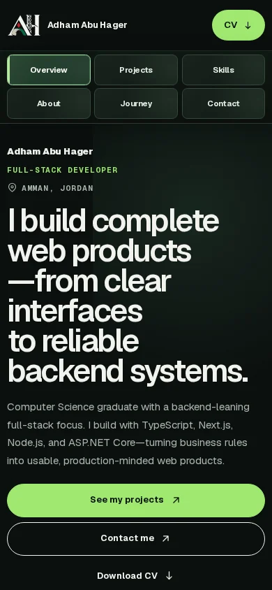

# Adham Abu Hager — Developer Portfolio

A responsive portfolio for **Adham Abu Hager**, a full-stack developer based in Amman, Jordan. It presents selected projects, engineering decisions, experience, training, and contact details in a compact interface.

[**Visit the portfolio**](https://www.adhamabuhagerdev.site/) · [GitHub](https://github.com/abuhager) · [LinkedIn](https://www.linkedin.com/in/adham-abuhager/)

**Next.js 16 · React 19 · TypeScript · CSS**

## Preview



<details>
<summary>View the mobile layout</summary>



</details>

These screenshots were captured from this repository running locally. Project images and the downloadable CV are bundled in `public/`.

## What visitors can explore

- **Overview:** introduction, featured work, and a downloadable CV.
- **About:** development approach and engineering priorities.
- **Skills:** frontend, backend, data, testing, and delivery tools.
- **Projects:** Five case studies — Aoun, UniEvents, HelpDesk SaaS, Khutwa Quran, and Don’t Control Yourself — with features, engineering decisions, screenshots, and demos or public source links.
- **Background:** experience, training, and education shown separately.
- **Contact:** email, LinkedIn, GitHub, and phone links.

The section cards and hash-based navigation let visitors switch views without leaving the page. The mobile layout uses the same content.

## Selected projects

| Project | What it demonstrates | Links |
| --- | --- | --- |
| **Aoun** | Arabic in-kind donation workflows, booking and waitlists, real-time chat, handover, and moderation | [Live application](https://www.aoun.website/) · [Frontend](https://github.com/abuhager/Aoun-Project_FrontEnd) · [Backend](https://github.com/abuhager/Aoun-Project_BackEnd) |
| **UniEvents** | Capacity-aware event booking, FIFO waitlist promotion, PDF tickets, attendance, and Excel exports | [Source and local demo](https://github.com/abuhager/privateevent) |

| **HelpDesk SaaS** | Company-scoped support tickets, Angular, ASP.NET Core, EF Core, and SQL Server | [Demo](https://helpdesk-abuhager.onrender.com) · Private source |
| **Khutwa Quran** | Guided learning, server-side assessment, content review, and offline practice | [Learning demo](https://khutwa-nine.vercel.app/demo) · Private source |
| **Don’t Control Yourself** | Cooperative platforming and puzzles for 2–4 players, Canvas simulation, and WebRTC rooms | [Play](https://dont-control-yourself-v80.freshglade128.chatgpt.site) · Private source |

HelpDesk screenshots use sample API responses. Khutwa is a learning prototype whose curriculum remains under preparation and review. The game is a playable prototype; online connectivity depends on network configuration.

## Implementation

- Next.js App Router with server-rendered content and client components for section selection and navigation.
- Typed portfolio content in [`lib/data.ts`](lib/data.ts); reusable UI components under [`components/`](components/).
- Local project media through `next/image`, and Geist fonts through `next/font`.
- Responsive CSS, visible focus states, a keyboard skip link, and reduced-motion support.
- Metadata, Open Graph images, manifest, sitemap, robots, icons, canonical URL, and Person structured data.

## Run locally

Use Node.js **24** and npm. The lockfile fixes the dependency versions.

```bash
git clone https://github.com/abuhager/my-portfolio.git
cd my-portfolio
npm ci
npm run dev
```

Open [http://localhost:3000](http://localhost:3000). No database or application secrets are required. The first build may need internet access to download the Google fonts used by `next/font`.

To run the production build:

```bash
npm run build
npm start
```

## Checks

```bash
npm run verify
```

`verify` runs ESLint, TypeScript checking, and the production build. The repository does not define a unit-test or end-to-end test script.

## Update the content

| Location | Purpose |
| --- | --- |
| [`lib/data.ts`](lib/data.ts) | Introduction, skills, projects, background, and contact links |
| [`components/sections/`](components/sections/) | Portfolio sections and case-study presentation |
| [`components/layout/`](components/layout/) | Navigation, view selection, and footer |
| [`app/`](app/) | Entry page, styling, routing, and metadata |
| [`public/projects/`](public/projects/) | Project screenshots |
| [`public/brand/`](public/brand/) | AH brand assets |
| [`public/resume.pdf`](public/resume.pdf) | Downloadable CV |

Keep project and experience claims aligned with the current CV and source repositories when editing `lib/data.ts`. Deployments are managed separately from this README.
